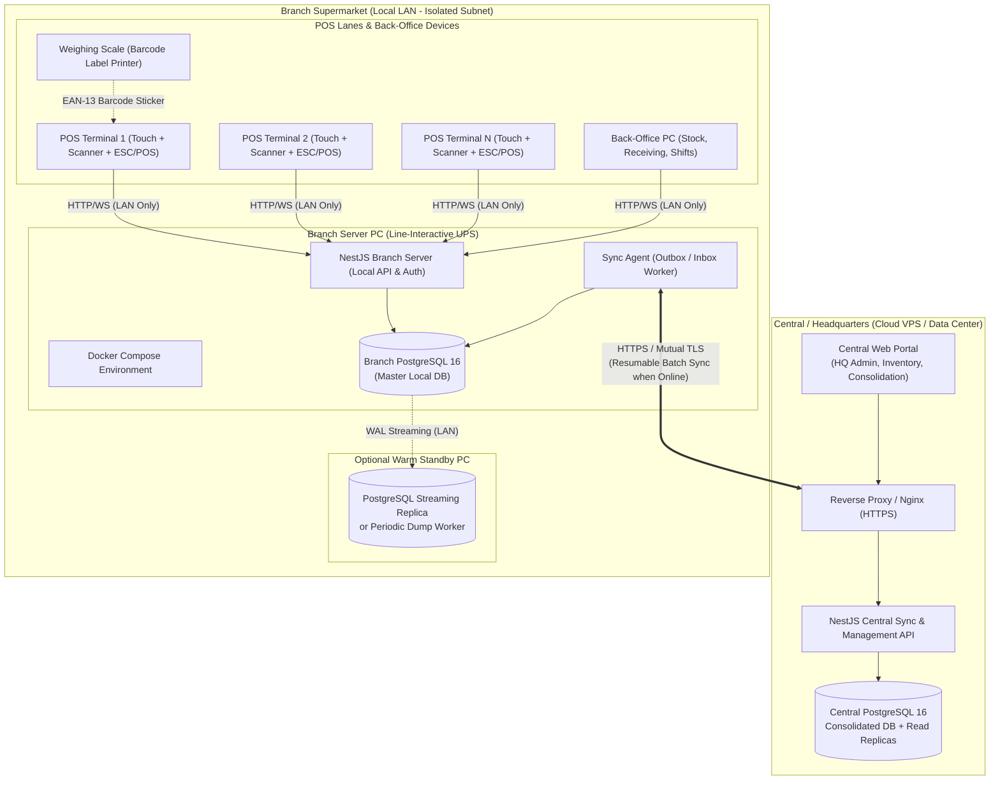
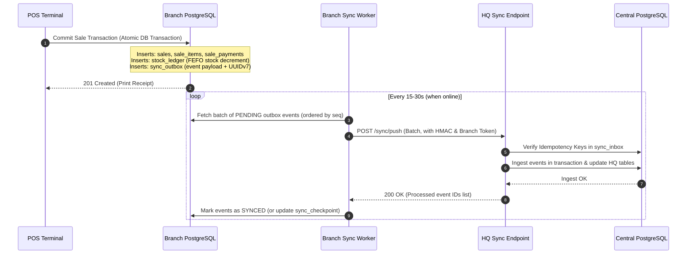
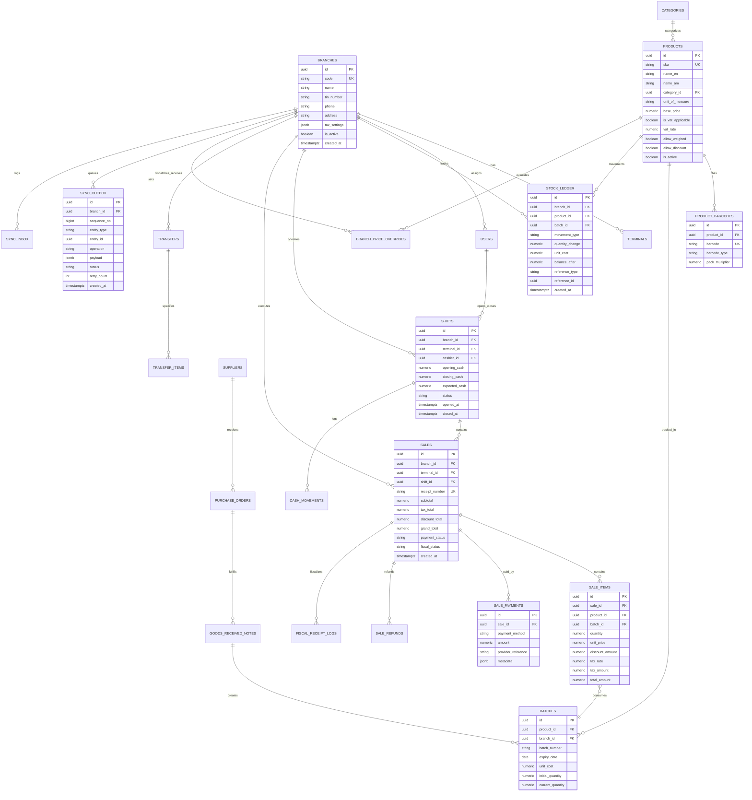

# GebeyaOS: Architecture Specification
**Production-Grade Multi-Branch Supermarket Management System (Local-Server-First)**
**Target Market:** Ethiopia (ETB, 15% VAT, MOR/ERCA Fiscalization, Amharic/English i18n, Ethiopic Calendar)

---

## 1. System Assumptions & Requirement Analysis

### 1.1 Stated Assumptions
1. **Network Reality in Ethiopia:** Internet connectivity via Ethio Telecom / Safaricom is subject to frequent outages, fiber cuts, and bandwidth throttling. Therefore, the branch local server is 100% self-sufficient. Terminals never communicate with Central directly.
2. **Power Grid Instability:** Power outages (load shedding) occur regularly. Every branch hardware setup mandates a line-interactive UPS on the branch server and terminal PCs. In sudden power cuts, PostgreSQL write-ahead logging (WAL) with `fsync=on` guarantees ACID durability.
3. **Tax & Fiscal Compliance (ERCA / MOR):** 
   - Standard VAT is 15%. Certain staple goods (e.g., bread, unprocessed cereals, medicines) are VAT-exempt (0% or exempted).
   - Ministry of Revenues (MOR) requires fiscal compliance: unique sequential fiscal invoice numbers, Electronic Journal (EJ), and daily Z-reports.
   - *Design Decision:* We implement an **Abstract Fiscal Driver Interface**. Standard operations print ESC/POS receipts with fiscal headers/footers, while reserving dedicated fields (`fiscal_receipt_no`, `fiscal_mrc`, `fiscal_sig`, `fiscal_counter`) to plug in Datecs, Daisy, Telpo serial/USB fiscal printers or the MOR e-tax API when activated.
4. **Currency & Precision:** All monetary amounts are handled in Ethiopian Birr (ETB) using `NUMERIC(14, 4)` in the database and integer cents/fixed-point in calculation engines to prevent floating-point rounding errors.
5. **Costing & Accounting Standard:** Ethiopian commercial code adheres to IFRS/GAAP standards. We implement **Weighted Average Costing (AVCO)** dynamically recalculated on Goods Received Notes (GRN), combined with **FEFO (First-Expired, First-Out)** batch tracking for perishables.
6. **Date & Localization:** The system stores all timestamps in UTC (`TIMESTAMPTZ`). The UI supports toggling between the Gregorian Calendar and the Ethiopian Calendar (using the Ge'ez 13-month calendar algorithm), with full English and Amharic (አማርኛ) locale support.

### 1.2 Challenged & Resolved Requirements
| Requirement | Potential Risk | Architectural Resolution |
| :--- | :--- | :--- |
| **Branch SQLite vs PostgreSQL** | Multi-terminal concurrent writes cause `SQLITE_BUSY` locks during peak hours; dialect mismatch with HQ PostgreSQL complicates sync schemas. | **Chosen:** PostgreSQL 16 in Docker Compose on branch server. Full JSONB support, native connection pooling, and identical SQL dialect. |
| **Sequential Receipt Numbering Offline** | Central auto-increment IDs fail when offline and cause collision when multiple branches sync to HQ. | **Chosen:** Composite offline-safe number: `{BRANCH_CODE}-{TERMINAL_CODE}-{YYYYMMDD}-{SHIFT_NO}-{SEQ}` backed by UUIDv7 primary keys. |
| **Negative Inventory Selling** | Real-world supermarket cashiers cannot stop checkout lines because a receiver hasn't logged a PO yet. | **Chosen:** Configurable branch policy (`ALLOW_NEGATIVE_STOCK: true/false`). If true, stock ledger records negative delta with `AUDIT_WARNING`, re-balanced on GRN. |
| **Payment Verification Offline** | Telebirr / CBE Birr QR/API cannot reach payment gateways without internet. | **Chosen:** Cash requires zero connectivity. Telebirr/CBE Birr operate in dual-mode: direct webhook/API when online, or manual SMS/USSD Transaction Reference input verified by cashier when offline. |

---

## 2. High-Level System Architecture

---

## 3. Deployment Model & Hardware Specifications

### 3.1 Minimum Hardware Specifications
- **Branch Server PC:**
  - CPU: Quad-Core Intel Core i5 / AMD Ryzen 5 (or modern mini-PC e.g., Intel N100/N305 minimum for small branches)
  - RAM: 16 GB DDR4 (minimum 8 GB dedicated to PostgreSQL + Docker)
  - Storage: 512 GB NVMe SSD (high endurance, TBW > 300)
  - Network: Dual Gigabit Ethernet ports (one for terminal LAN, one isolated/WAN for router)
  - Power: 1000VA - 1500VA Line-Interactive UPS with USB communication cable (for automated graceful shutdown if battery hits < 15%)
- **POS Terminal:**
  - All-in-one POS touch terminal or desktop PC with 4-8 GB RAM, 128 GB SSD
  - 80mm USB/LAN ESC/POS Thermal Receipt Printer
  - 1D/2D Barcode Scanner (Honeywell/Datalogic/Zebra or compatible USB HID)
  - Cash Drawer connected via RJ11 to thermal printer
- **Branch Network:**
  - Dedicated 16/24-port Managed Gigabit Switch with isolated VLAN for POS (no customer Wi-Fi access)
  - Static IP assignment for Branch Server (`192.168.10.10`)

### 3.2 High-Availability & Warm Standby Strategy
1. **Primary Branch Server:** Runs Docker Compose containing `postgres`, `branch-api`, `caddy/nginx` reverse proxy, and local backup scheduler.
2. **Warm Standby (Terminal 2 or Back-Office PC):**
   - Configured with identical Docker Compose setup.
   - Continuously receives PostgreSQL base backups and WAL streaming replication or hourly automated transaction diffs.
   - If Primary Server suffers physical motherboard/power supply failure: Manager runs a single CLI command (`./failover.sh promote`) on Standby; router or local DNS maps `server.branch.lan` to Standby IP. Terminals reconnect within 60 seconds with zero data loss.

---

## 4. Multi-Tenancy & Data Scope

### 4.1 Identifiers & Branch Scoping
- **Primary Keys:** Exclusively **UUIDv7** (`uuid_generate_v7()` or application-generated).
  - *Why UUIDv7?* Time-ordered, monotonic B-tree indexing prevents index fragmentation, collision-free generation across multiple disconnected branch servers.
- **Branch Boundary:** Every transactional table contains `branch_id UUID NOT NULL REFERENCES branches(id)`.
- **Row-Level Security & Filters:** Branch servers enforce query filters ensuring no cross-contamination. HQ database partitions large tables (e.g., `stock_ledger`, `sale_items`) by `branch_id` for query isolation and rapid analytical rollups.

### 4.2 Authority Matrix (HQ vs Branch)
| Domain Entity | Authority | Replication Direction | Conflict Resolution Rule |
| :--- | :---: | :---: | :--- |
| **Product Master Catalog** | HQ | HQ &rarr; Branch | HQ Always Wins (Overwrites branch catalog attributes) |
| **Base Selling Prices** | HQ | HQ &rarr; Branch | HQ Wins, unless Branch Price Override is enabled |
| **Branch Price / Tax Override** | Branch/HQ | Bidirectional | HQ approved override takes precedence |
| **Users, Roles & Permissions** | HQ | HQ &rarr; Branch | HQ Authoritative (Security audit centralized) |
| **Sales & Receipts** | Branch | Branch &rarr; HQ | Branch Always Wins (Append-only; HQ cannot alter sales) |
| **Stock Ledger (Local movements)** | Branch | Branch &rarr; HQ | Branch Always Wins (Append-only ledger entries) |
| **Inter-Branch Transfers** | Dual | Branch &harr; HQ &harr; Branch | State-Machine transition tokens (DISPATCHED &rarr; RECEIVED) |
| **Physical Stock Counts** | Branch | Branch &rarr; HQ | Branch Authoritative for local inventory adjustments |
| **Shifts & Cash Reconciliation**| Branch | Branch &rarr; HQ | Branch Always Wins (Immutable local register event) |

---

## 5. Bidirectional Synchronization Architecture

### 5.1 Outbox & Inbox Event-Driven Sync

### 5.2 Conflict Resolution & Edge Cases
1. **Idempotency Keys:** Every sync payload carries an `idempotency_key: {source_branch_id}_{entity_id}_{operation}_{version}`. If network disconnects after HQ processes the batch but before the branch receives the 200 ACK, re-sending the same batch is a safe no-op.
2. **Clock Skew Tolerance:** No business logic depends on client wall-clock time. Every transaction stores:
   - `client_timestamp`: terminal clock for display.
   - `server_timestamp`: local branch server authoritative time.
   - `sync_timestamp`: HQ ingestion time.
   - Ordering uses monotonically increasing sequence numbers (`BIGSERIAL` in outbox) and UUIDv7.
3. **Resumable Batching:** Sync pulls in chunks of 100-500 events using cursor-based pagination. If an HTTP connection terminates mid-transfer, only the unacknowledged cursor slice is retried with exponential backoff (1s, 2s, 5s, 10s, up to max 60s).

---

## 6. Failure Scenarios & Self-Healing Matrix

| Failure Event | Immediate Impact | Mitigation & Recovery Procedure | Data Integrity Guarantee |
| :--- | :--- | :--- | :--- |
| **Sudden Power Loss Mid-Sale** | Terminal and/or server PC shuts off during checkout. | Line-interactive UPS provides ~15-30 min runtime. If instantaneous drop, PostgreSQL WAL replay rolls back uncommitted dirty buffers. POS loads previous state; unfinalized sale was never committed or was fully committed. | Zero orphaned records; DB integrity 100% preserved via ACID WAL. |
| **Branch SSD / Hard Drive Corruption** | Primary branch server fails to boot or PostgreSQL data directory corrupted. | 1. Warm Standby PC promoted via script in < 2 mins. 2. If no standby, automated daily encrypted backup on secondary USB/LAN drive restored via `docker compose run restore`. | Max data loss = transactions since last automated WAL backup or zero if warm replica used. |
| **Internet Severed for 7+ Days** | No connection to Central HQ. | Branch operates 100% normally. Local sales, receipts, inventory counts, purchasing, and shifts continue with zero interruption. Outbox accumulates events cleanly in local PostgreSQL. | No data loss. Upon reconnection, sync worker drains backlog via throttled chunked batches. |
| **Two Terminals Scan Last Physical Unit** | 1 unit left on shelf; Cashier A and Cashier B scan and tender at the exact same moment. | POS checkout executes `SELECT ... FOR UPDATE` on the stock batch ledger. First terminal commits; second terminal receives `INSUFFICIENT_STOCK` error or triggers manager negative-stock override depending on branch policy. | Prevents silent inventory race conditions; ledger accurately reflects exact batch allocations. |
| **Duplicate Sync Packet Received at HQ** | Network drops after HQ commit but before branch receives ACK. Branch retries. | Central `sync_inbox` enforces unique constraint on `(source_branch_id, entity_type, entity_id, sequence_no)`. Duplicate event is acknowledged without re-applying. | Zero duplicate sales or duplicated ledger decrements. |
| **Terminal Clock Wrong (e.g., CMOS dead)** | Terminal CMOS battery died, clock reset to 2000-01-01. | POS terminal syncs time from Branch Server via WebSocket/NTP handshake on login. Server rejects any sale where `abs(terminal_time - server_time) > 300s`. Server timestamp is authoritative. | Accurate financial date reporting, shift reconciliation, and audit logs. |

---

## 7. Trade-Off Analysis

| Decision | Selected Option | Rejected Alternative | Technical Justification |
| :--- | :--- | :--- | :--- |
| **Branch DB** | **PostgreSQL 16** | SQLite (WAL mode) | SQLite write concurrency lock (`SQLITE_BUSY`) during 4-terminal peak checkout creates latency spikes. Identical schema/dialects between branch and HQ eliminate dual-ORM maintenance. |
| **Primary Keys** | **UUIDv7** | Auto-increment `BIGINT` or UUIDv4 | Auto-increment collides across branches. UUIDv4 destroys B-tree index cache locality due to random distribution. UUIDv7 provides temporal sortability with zero multi-master collisions. |
| **Stock Ledger** | **Append-Only Event Ledger** | Mutable `product.quantity_on_hand` column | Mutable counters cannot be audited, reconciled with past GRNs, or synced safely across branches. Append-only ledger enables time-travel inventory, FEFO batch tracking, and audit perfection. |
| **Sync Protocol** | **HTTP REST / Batch JSON with Outbox** | Direct PostgreSQL Logical Replication | Logical replication requires constant high-bandwidth, direct WAN DB port exposure (security vulnerability), and breaks under schema alterations or flaky internet. Outbox REST sync is resilient, inspectable, and firewall-friendly. |
| **Costing Model** | **Weighted Average Cost (AVCO)** | Standard / Manual Costing | AVCO automatically updates unit valuation on every partial GRN receiving, reflecting actual inflation and foreign exchange shifts in Ethiopia accurately. |

---

## 8. Entity Relationship Diagram (ERD)

