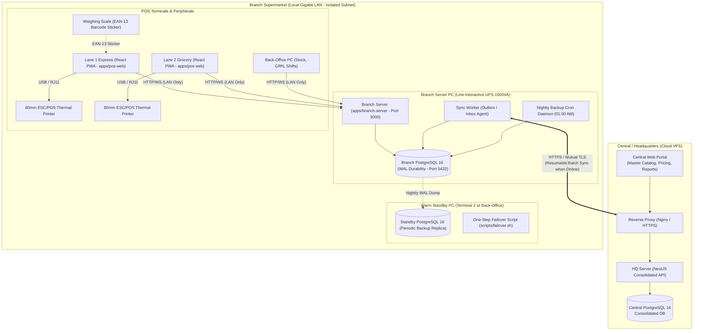

# GebeyaOS: Architecture Specification
**Production-Grade Multi-Branch Supermarket Management System (Local-Server-First)**
**Target Market:** Ethiopia (ETB, 15% VAT, MOR/ERCA Fiscalization, Amharic/English i18n, Ethiopic Calendar)

---

## 1. System Topology & Core Principle: Local-Server-First

Each branch supermarket functions as an autonomous, self-contained computing island. All POS lanes, barcode scanners, produce/butchery scales, receipt printers, and back-office terminals communicate **only** over the local branch LAN to the Branch Server.

---

## 2. Deployment Model & Hardware Specifications

### 2.1 Hardware Requirements
- **Primary Branch Server:**
  - CPU: Quad-Core Intel Core i5 / AMD Ryzen 5 (or modern mini-PC e.g., Intel N100/N305 minimum).
  - RAM: 16 GB DDR4 (8 GB minimum dedicated to PostgreSQL + Docker).
  - Storage: 512 GB NVMe SSD (High TBW rating, enterprise endurance).
  - Power: 1000VA - 1500VA Line-Interactive UPS with USB communication cable (auto-graceful shutdown if battery < 15%).
  - Network: Dedicated Gigabit Switch with isolated VLAN for POS (no customer Wi-Fi access). Static IP `192.168.10.10`.
- **POS Terminals:**
  - Touchscreen POS terminal or Desktop PC with 4-8 GB RAM, 128 GB SSD.
  - 80mm ESC/POS Thermal Receipt Printer (USB or Ethernet).
  - 1D/2D Barcode Scanner (USB HID).
  - Cash Drawer connected via RJ11 to printer.
- **Warm Standby (Terminal 2 or Manager PC):**
  - Pre-installed Docker Compose setup with `scripts/failover.sh` ready to assume primary server IP in < 2 minutes upon server motherboard/PSU failure.

### 2.2 Network & Power Cut Behavior
- **LAN-Only Operation:** Branch server binds only to the internal LAN subnet (`192.168.10.0/24`). Zero external inbound ports are opened.
- **Power Failure Durability:** PostgreSQL WAL is configured with `wal_level=replica`, `fsync=on`, and `synchronous_commit=on`. In an instantaneous power cut, the filesystem dirty buffers are flushed or replayed from WAL upon reboot, guaranteeing zero orphaned records or corrupt pages.

---

## 3. Multi-Tenancy & Data Scope

### 3.1 Identifiers & Branch Scoping
- **Primary Keys:** Exclusively **UUIDv7** (`uuid_generate_v7()` natively in PostgreSQL or application layer).
  - *Why UUIDv7?* Time-ordered, monotonic B-tree indexing prevents index fragmentation, collision-free generation across multiple disconnected branch servers.
- **Branch Boundary:** Every transactional table contains `branch_id UUID NOT NULL REFERENCES branches(id)`.
- **Row-Level Security & Filters:** Branch servers enforce query filters ensuring no cross-contamination. HQ database partitions large tables (e.g., `stock_ledger`, `sale_items`) by `branch_id` for query isolation and rapid analytical rollups.

### 3.2 Authority Matrix (HQ vs Branch)
| Domain Entity | Authority | Replication Direction | Conflict Resolution Rule |
| :--- | :---: | :---: | :--- |
| **Product Master Catalog** | HQ | HQ &rarr; Branch | HQ Always Wins (Overwrites branch catalog attributes) |
| **Base Selling Prices** | HQ | HQ &rarr; Branch | HQ Wins, unless Branch Price Override is enabled |
| **Branch Price / Tax Override** | Branch/HQ | Bidirectional | Branch override takes precedence for local sales |
| **Users, Roles & Permissions** | HQ | HQ &rarr; Branch | HQ Authoritative (Security audit centralized) |
| **Sales & Receipts** | Branch | Branch &rarr; HQ | Branch Always Wins (Append-only; HQ cannot alter sales) |
| **Stock Ledger (Local movements)** | Branch | Branch &rarr; HQ | Branch Always Wins (Append-only ledger entries) |
| **Inter-Branch Transfers** | Dual | Branch &harr; HQ &harr; Branch | State-Machine transition tokens (DISPATCHED &rarr; RECEIVED) |
| **Physical Stock Counts** | Branch | Branch &rarr; HQ | Branch Authoritative for local inventory adjustments |
| **Shifts & Cash Reconciliation**| Branch | Branch &rarr; HQ | Branch Always Wins (Immutable local register event) |

---

## 4. Synchronization Architecture

### 4.1 Outbox & Inbox Event-Driven Sync
1. **Local Transactional Outbox:** Every domain mutation (sale, return, shift close, stock adjustment, GRN) inserts an event into `sync_outbox` inside the same atomic database transaction.
2. **Monotonic Sequence Numbers:** `sync_outbox` assigns a `BIGSERIAL sequence_no`. Events are streamed in strict causal order.
3. **Cursor-Based Chunking:** The sync worker queries `WHERE sequence_no > afterSequence ORDER BY sequence_no ASC LIMIT 200`.
4. **Idempotency Keys:** Every event carries a deterministic idempotency key `{source_branch_id}_{entity_type}_{entity_id}_{sequence_no}`. The Central `sync_inbox` enforces a unique constraint on `idempotency_key`, making duplicate deliveries safe no-ops.
5. **Clock-Skew Mitigation:** Ordering uses sequence numbers and UUIDv7, not client wall clocks. All records capture `client_timestamp`, `server_timestamp`, and `created_at`.
6. **Exponential Backoff:** If the branch internet is down or HQ is unreachable, the sync agent retries with exponential backoff:
   $$\text{Delay} = \min(60000, 1000 \times 2^{\text{attempt}}) + \text{jitter}$$

---

## 5. Trade-Off Analysis

| Decision | Chosen Option | Rejected Alternative | Technical Justification |
| :--- | :--- | :--- | :--- |
| **Branch DB** | **PostgreSQL 16 in Docker** | SQLite (WAL mode) | SQLite write concurrency lock (`SQLITE_BUSY`) during 4-terminal peak checkout creates latency spikes. Identical schema/dialects between branch and HQ eliminate dual-ORM maintenance. |
| **Primary Keys** | **UUIDv7** | Auto-increment `BIGINT` or UUIDv4 | Auto-increment collides across branches. UUIDv4 destroys B-tree index cache locality due to random distribution. UUIDv7 provides temporal sortability with zero multi-master collisions. |
| **Stock Ledger** | **Append-Only Event Ledger** | Mutable `product.quantity_on_hand` column | Mutable counters cannot be audited, reconciled with past GRNs, or synced safely across branches. Append-only ledger enables time-travel inventory, FEFO batch tracking, and audit perfection. |
| **Sync Protocol** | **HTTP REST / Batch JSON with Outbox** | Direct PostgreSQL Logical Replication | Logical replication requires constant high-bandwidth, direct WAN DB port exposure (security vulnerability), and breaks under schema alterations or flaky internet. Outbox REST sync is resilient, inspectable, and firewall-friendly. |
| **Costing Model** | **Weighted Average Cost (AVCO)** | Standard / Manual Costing | AVCO automatically updates unit valuation on every partial GRN receiving, reflecting actual inflation and foreign exchange shifts in Ethiopia accurately. |
