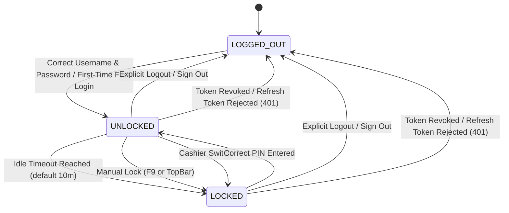
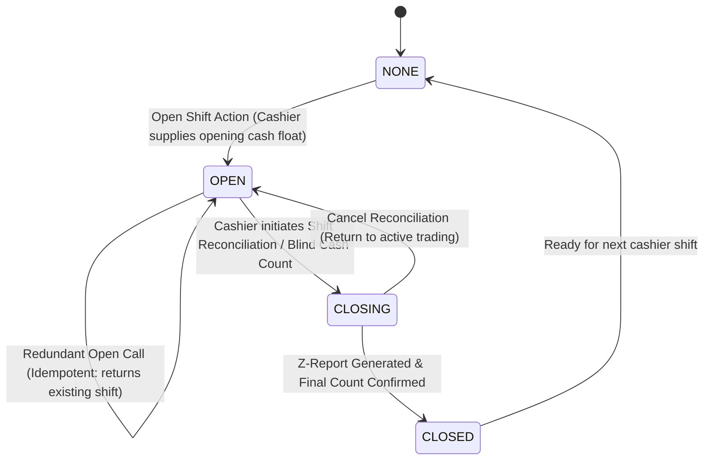

# GebeyaOS POS Stabilization State Machines

This document formalizes the state machines and single-source-of-truth store architecture for GebeyaOS POS. These rules eliminate repeated PIN prompts, repeated shift opening prompts, and state desynchronization across routes, tab switches, and page refreshes.

---

## 1. Session State Machine

### 1.1 States & Diagram

The session has exactly three primary states:
- `LOGGED_OUT`: No valid authentication credentials or session tokens exist. The user must authenticate with credentials (username/phone + password or initial cashier PIN).
- `LOCKED`: An active authenticated session exists, but the terminal is locked (e.g., via idle timeout, cashier switch, or manual F9 lock). The screen is covered by the PIN unlock pad. Background state (such as held baskets and active shift) is strictly preserved.
- `UNLOCKED`: The session is fully active. The user has access to authorized tabs, catalog, and checkout actions.



### 1.2 State Transition Table

| Current State | Trigger / Event | Target State | Action / Side Effects |
| :--- | :--- | :--- | :--- |
| `LOGGED_OUT` | `LOGIN_SUCCESS` | `UNLOCKED` | Store tokens (`accessToken`, `refreshToken`, `currentUser`), set `sessionState = 'UNLOCKED'`, arm idle timer, resolve terminal config, fetch active shift. |
| `UNLOCKED` | `IDLE_TIMEOUT` | `LOCKED` | Set `sessionState = 'LOCKED'`, persist lock flag to `sessionStorage`, display PIN Pad modal. Keep basket, shift, and network sync intact. |
| `UNLOCKED` | `MANUAL_LOCK` (F9 / button) | `LOCKED` | Set `sessionState = 'LOCKED'`, persist lock flag to `sessionStorage`, display PIN Pad modal. |
| `UNLOCKED` | `SWITCH_CASHIER` | `LOCKED` | Set `sessionState = 'LOCKED'`, prompt for new cashier PIN. |
| `LOCKED` | `PIN_UNLOCK_SUCCESS` | `UNLOCKED` | Clear lock flag in `sessionStorage`, set `sessionState = 'UNLOCKED'`, reset idle timer, update active cashier if switched. |
| `LOCKED` | `PIN_FAIL` | `LOCKED` | Increment failed attempts counter. If attempts >= 5, lock account for 5 minutes. |
| `LOCKED` or `UNLOCKED` | `MANUAL_LOGOUT` | `LOGGED_OUT` | Revoke tokens on server, clear all auth tokens and lock flags from storage, reset stores, redirect to login screen. |
| `LOCKED` or `UNLOCKED` | `TOKEN_REVOKED` (401 refresh failed) | `LOGGED_OUT` | Clear expired tokens, show session expired prompt preserving draft baskets. |
| Any | `PAGE_REFRESH` (F5) / `ROUTE_CHANGE` | *Preserved* | **Must NOT change state.** If previously `LOCKED`, restore as `LOCKED`. If previously `UNLOCKED`, validate session against server profile and restore as `UNLOCKED`. |

### 1.3 Persistence & Page Refresh Guarantees
- The lock state is persisted in `sessionStorage.getItem('gebeyaos_session_locked') === 'true'`.
- On application load or page reload (`F5`):
  1. If `accessToken` or `refreshToken` exists, probe `/api/auth/me` (or `/api/auth/profile`).
  2. If the user was `LOCKED` prior to refresh, restore directly to `LOCKED` (PIN pad displayed, session retained).
  3. If the user was `UNLOCKED`, restore to `UNLOCKED` without prompting for PIN or password.
  4. If tokens are invalid or expired, gracefully transition to `LOGGED_OUT`.
- Route changes (switching between Checkout, Shift, Catalog, Inventory, Settings) **never** alter session or lock state.

---

## 2. Idle Lock Sub-System

### 2.1 Rules & Activity Tracking
1. **Reset Triggers:** The inactivity timer restarts on **any** of the following user actions:
   - Pointer events: `pointerdown`, `pointermove`, `mousedown`.
   - Keyboard events: `keydown`, `keyup`.
   - Barcode Scanner activity: Synthetic key events or hardware barcode wedge inputs.
   - Network activity: Successful outbound API requests made through `fetchWithAuth`.
2. **Capture Phase:** Event listeners are registered on `window` using `{ capture: true }` so that nested components or `e.stopPropagation()` calls never suppress the idle timer reset.
3. **Configurable Timeout:**
   - Default: **10 minutes** (600,000 ms).
   - Read from `terminalConfig.autoLockMinutes` or `systemSettings.idleTimeoutMinutes`.
   - Minimum enforced limit: 1 minute.
4. **Modal / In-Flight Pause Invariant (Critical):**
   - The idle timer **MUST NOT trigger** when:
     - Payment modal (`PaymentModal`) is open.
     - Weight scale modal (`WeightModal`) is open.
     - Refund modal (`RefundModal`) is open.
     - Open Shift modal (`OpenShiftModal`) is open.
     - Any full-screen confirmation or transaction processing dialog is active.
   - When an interactive modal is active, the idle timer is paused; it arms again once all modals close.

---

## 3. Shift State Machine

### 3.1 States & Diagram



### 3.2 Shift State Definitions
- `NONE`: No active shift exists for this terminal and branch. The POS blocks checkout until an opening float is provided.
- `OPEN`: An active shift is open for the terminal. Cashiers can ring up sales, process payments, and perform cash drops.
- `CLOSING`: The cashier is conducting shift-end blind cash count, X-report verification, or variance calculation.
- `CLOSED`: Shift is finalized. Z-report and fiscal logs are written. Terminal transitions back to `NONE`.

### 3.3 Shift Lifecycle & Idempotency Guarantees
1. **Single Source of Truth:**
   - The server PostgreSQL `shifts` table is the sole source of truth:
     ```sql
     SELECT * FROM shifts WHERE branch_id = $1 AND terminal_id = $2 AND status = 'OPEN' ORDER BY opened_at DESC LIMIT 1;
     ```
   - All components (`PosCheckout`, `ShiftManagement`, `TopBar`, `Dashboard`) read from a single shared `ShiftStore` (`ShiftContext`).
2. **Terminal Identity Resolution:**
   - All shift queries use the active terminal's verified UUID (`terminalConfig.terminalId`), never mismatched hardcoded constants (`...0031` vs `...0010`).
   - If not explicitly paired, the application queries `/api/system/terminals` to resolve the default active terminal for the branch.
3. **Idempotent Open Shift (`POST /api/pos/shifts/open`):**
   - If a shift is already `OPEN` for `terminalId`, the backend MUST return `200 OK` with the existing open shift object, rather than throwing `400 BadRequestException`.
   - The frontend never falls back to dummy `shift-offline-${Date.now()}` unless the network is completely unreachable and offline mode is explicitly engaged.
4. **No Repeated Shift Prompts on Navigation:**
   - On initial app boot, `ShiftStore` fetches the current shift from the server once.
   - If a shift is `OPEN`, the `OpenShiftModal` is suppressed across all views.
   - Navigating between tabs (Checkout -> Shifts -> Inventory -> Checkout) reads directly from `ShiftStore` without triggering modal popups or re-fetching unneeded floats.

---

## 4. One Store Per Concern Architecture

To prevent split-brain state, GebeyaOS enforces strict domain isolation:

```
┌────────────────────────────────────────────────────────┐
│                      GebeyaOS App                      │
└──────────────────────────────────┬─────────────────────┘
                                   │
      ┌────────────────────────────┼───────────────────────────┐
      │                            │                           │
┌─────▼──────────┐         ┌───────▼────────┐          ┌───────▼────────┐
│  SessionStore  │         │   ShiftStore   │          │  BasketStore   │
│ (AuthContext)  │         │ (ShiftContext) │          │  (Cart/Basket) │
├────────────────┤         ├────────────────┤          ├────────────────┤
│ • currentUser  │         │ • currentShift │          │ • cart items   │
│ • tokens       │         │ • shiftStatus  │          │ • discounts    │
│ • sessionState │         │ • openShift()  │          │ • customer     │
│ • terminalId   │         │ • closeShift() │          │ • heldBaskets  │
│ • idleTimer    │         │ • refresh()    │          │ • clearCart()  │
└────────────────┘         └────────────────┘          └────────────────┘
```

1. **`SessionStore` (`AuthContext`):**
   - Sole authority on authentication status, user profile, role permissions, terminal identity, and lock/unlock state.
2. **`ShiftStore` (`ShiftContext`):**
   - Sole authority on active shift for the paired terminal.
   - Shared by `PosCheckout`, `ShiftManagement`, `TopBar`, and `DashboardView`.
   - Eliminates duplicate `useState<Shift | null>` in components.
3. **`BasketStore` (`useCart` / `BasketContext`):**
   - Sole authority on line items, quantities, basket-level discounts, customer binding, and held receipts.
   - Retained in memory and synchronized to `localStorage` for offline crash-recovery.
4. **`SettingsStore` / REST APIs:**
   - System settings (tax rates, idle timeout, receipt templates, printer endpoints) loaded on demand via `/api/system/settings`.
   - No mock data fallbacks: all components consume real REST endpoints connected to PostgreSQL.

